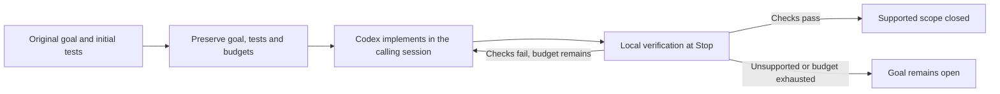

# GoalPilot

**Make coding goals verifiable. Spend less effort on repeated work.**

GoalPilot is a Codex skill backed by a local Python engine. It preserves your original goal and tests, gives the coding session a clear verification path, and checks the result before accepting completion. Failed checks send the same session back to repair, within the original deadline and verification budget.

[](pyproject.toml)
[](skills/goalpilot/SKILL.md)
[](goalpilot/__init__.py)

[Get started](docs/GETTING_STARTED.md) · [How it works](docs/ARCHITECTURE.md) · [Benchmark methodology](docs/BENCHMARKS.md) · [Contributing](CONTRIBUTING.md)

## Measured performance

On **20 selected synthetic Python service missions**, the complete GoalPilot invocation used **54.39% fewer raw tokens** and **60.66% less total time** than native Codex `/goal`.


| Metric — all 20 attempts per arm | Native Codex | GoalPilot | Reduction |
| :--- | ---: | ---: | ---: |
| Total elapsed time | 65.32 min | 25.69 min | **60.66%** |
| Uncached input tokens | 499,412 | 256,343 | **48.67%** |
| Output tokens | 221,009 | 86,013 | **61.08%** |
| Raw tokens, including cached input | 4,716,581 | 2,151,252 | **54.39%** |
| Correct, normally closed goals — reviewed scoring | 19/20 | 20/20 | Observed count preserved |
| Correct, normally closed goals — original scoring | 17/20 | 19/20 | Observed count preserved |

**What these numbers cover:** the entire calling session, including skill setup and reading, context, coding, repairs and Stop verification, plus independent judging time. Failed attempts remain in the totals. Both arms used `gpt-6.1-sol`, LOW effort and matching execution permissions. Native Codex used its real goal API and automatic continuations.

**What they do not establish:** savings on arbitrary repositories, multi-hour production goals or other agents. These are known development cases in one Python/JSONL/HTTP service family, not a blinded holdout. Two symmetric grading reviews are disclosed alongside the unchanged original scores; both score definitions meet the accepted benchmark thresholds. Provider tokens do not map directly to subscription quota percentages. See the [methodology, uncertainty and research cost](docs/BENCHMARKS.md).

## Install

Requirements: **Python 3.11+, a POSIX environment, and an authenticated Codex CLI**. The measured environment used Linux, Python 3.12.14 and Codex CLI 0.163.0. Other CLI versions may need compatibility checks.

```bash
git clone https://github.com/InfinitySpeed/goalpilot.git
cd goalpilot
python3 skills/goalpilot/scripts/install.py
python3 ~/.agents/skills/goalpilot/scripts/goalpilot.py hook-config install
```

Restart Codex if needed to discover the installed skill, then invoke it:

```text
$goalpilot Add durable task scheduling to this Python service. Preserve its current
API and data. Cover scheduling, cancellation, restart recovery and concurrent
workers with meaningful tests. Finish only when the frozen checks pass.
```

No separate inference service, Python runtime dependencies or additional API key is required for the default skill path. **Codex still consumes tokens.** Installation and the passive monitor do not create model calls.

See [setup, manual operation and troubleshooting](docs/GETTING_STARTED.md).

## How it works



- **Preserve acceptance.** Initial tests are retained. The strengthened suite and submitted checks are frozen before final verification, so weakening a working test cannot erase the initial gate.
- **Reduce repeated work.** Compact context, exact-hash helper reuse and optional storage/transport/test helpers avoid repeatedly generating the same infrastructure.
- **Diagnose loops locally.** Hooks observe supported commands and report repeated failures; they do not launch another model or silently retry the task.
- **Verify completion.** Successful verification requires the retained original suite, the strengthened suite and submitted checks. Unsupported verification remains open.

Passing tests establishes the supported checked scope. It does not prove every unstated intention in a vague goal. Read the [architecture and boundaries](docs/ARCHITECTURE.md).

## Compatibility

| Host or project | Current status |
| :--- | :--- |
| Codex CLI | Implemented and benchmarked integration |
| Bounded Python `unittest` projects with compatible initial tests | Supported verification path |
| Claude Code, Antigravity and other agents | No released adapter; local engine reuse needs integration and testing |
| Other test frameworks, oversized snapshots, unsupported environments | Supported closure is not claimed |

Optional helpers suit their documented interfaces. `ReplayService` is intended for new pure applications with a compatible storage format; existing formats and external side effects require a different strategy. See [architecture](docs/ARCHITECTURE.md).

## Development

The engine uses the Python standard library. The published version has **283 passing offline tests, with no skips**.

```bash
python3 validate.py
python3 tools/check_benchmark.py
python3 tools/build_skill.py
```

`dist/goalpilot-skill.zip` contains the self-contained installable skill. These commands run local verification and packaging; they do not launch model benchmarks. See [CONTRIBUTING.md](CONTRIBUTING.md) for chart generation and measurement rules.
