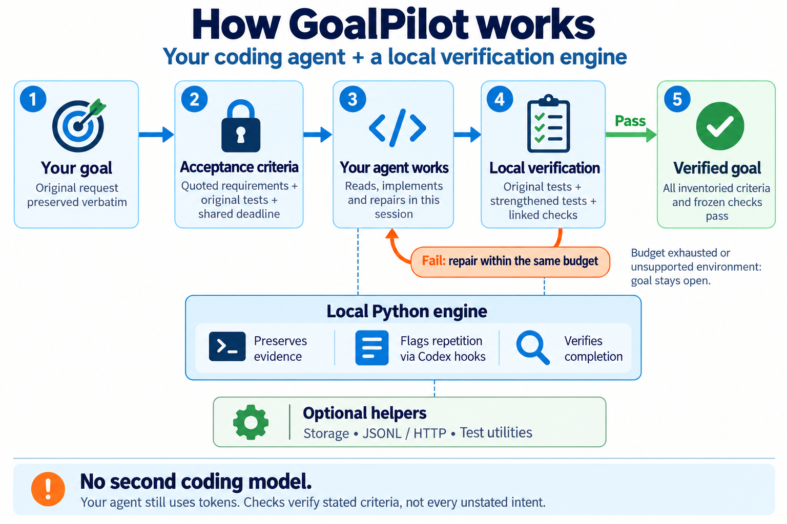
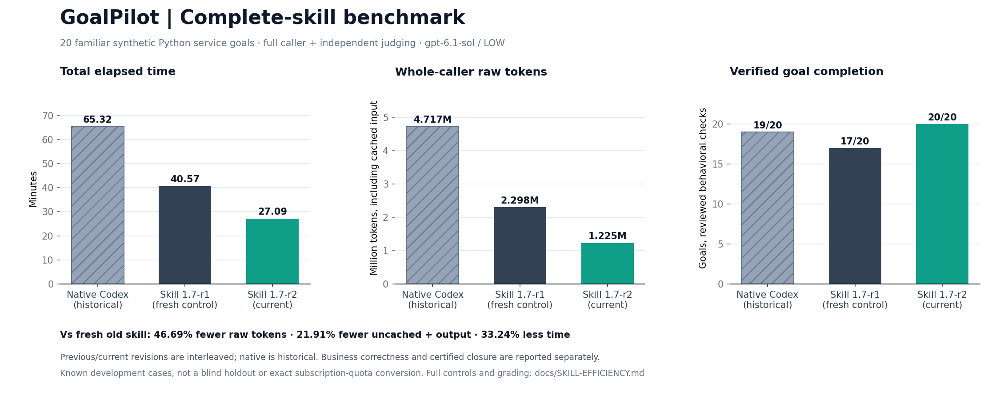
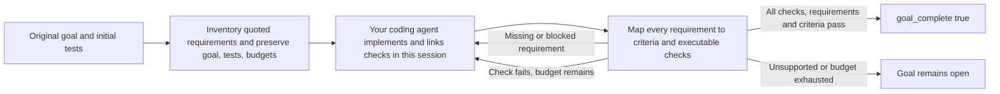

# GoalPilot

**A skill that helps coding agents turn ambitious goals into verified results, with less repeated work.**

GoalPilot preserves your original request, turns it into explicit criteria, reuses tested infrastructure and verifies the result before reporting completion. It works inside your current coding-agent session. The default is **Skill 1.7.0-r2 with engine 0.16.0**; it does not start a second coding model.

[](https://github.com/InfinitySpeed/goalpilot/actions/workflows/ci.yml)
[](pyproject.toml)
[](https://github.com/InfinitySpeed/goalpilot/releases/latest)
[](PORTABLE_SKILL.json)

[Install and use](#how-to-use-it) · [How it works](#how-it-works) · [Performance and evidence](docs/SKILL-EFFICIENCY.md) · [Supported hosts](docs/HOSTS.md) · [Contributing](CONTRIBUTING.md)



[Open the full-size backend infographic](docs/assets/goalpilot-backend.png).

## Measured results



**20 familiar synthetic Python service goals**, with a fresh interleaved Skill 1.7.0-r1 control. Native Codex is a frozen historical reference on the same goals.

| All 20 attempts per arm | Native Codex, historical | Previous revision, fresh | Default 1.7.0-r2 |
| :--- | ---: | ---: | ---: |
| Verified goals | 19/20 | 17/20 | **20/20** |
| Independent business validation | 19/20 | 19/20 | **20/20** |
| Raw tokens, including cached input | 4,716,581 | 2,298,301 | **1,225,323** |
| Uncached input + output | 720,421 | 391,869 | **306,027** |
| Total elapsed time | 65.32 min | 40.57 min | **27.09 min** |

Versus the freshly rerun previous revision: **46.69% fewer raw tokens, 21.91% fewer uncached+output tokens and 33.24% less time**. Only the skill instructions changed; the engine, helpers and adapters are identical. Every attempt, including control failures, is included.

Verified closure includes GoalPilot's frozen checks; business correctness is independently scored. Two control artifacts were business-correct but blocked by their own frozen tests; one failed independent business review. [Definitions, individual cases and full controls](docs/SKILL-EFFICIENCY.md).

These are known development cases, not a blind holdout, production guarantee, proof of universal superiority or exact subscription-quota savings. Codex POSIX, exact native Stop hooks, `gpt-6.1-sol`, low effort and matched permissions were measured. Other hosts are locally tested only. Historical older GoalPilot and standalone observations remain visible in the [complete comparison](docs/SKILL-EFFICIENCY.md#results).

## How to use it

These instructions install **Skill 1.7.0-r2 with the frozen engine 0.16.0** in your current coding-agent session.

### 1. Send this to your coding agent

```text
Install GoalPilot from https://github.com/InfinitySpeed/goalpilot for the agent
I am using. Follow INSTALL.md, handle the runtime and skill registration yourself,
and confirm the local doctor check passes. Do not run benchmarks or start another
coding agent. Then tell me how to invoke GoalPilot here.
```

Or install and start your first task in one prompt:

```text
Install GoalPilot from https://github.com/InfinitySpeed/goalpilot if needed,
then use it to achieve this goal: [YOUR COMPLETE GOAL].
Work in this session, preserve existing tests and data, and verify the result
before reporting completion.
```

The agent handles source download, Python runtime setup, host selection and installation. It needs terminal access and normal permission to install user-local files. **Agents installing this repository: read [INSTALL.md](INSTALL.md) and complete the requested setup.** No manual Git or Python management is needed through the bootstrap.

### 2. Give it an objective

| Tool | Ready-to-copy prompt after installation |
| :--- | :--- |
| Codex | `$goalpilot [YOUR COMPLETE GOAL]. Preserve existing behavior and verify before concluding.` |
| Claude Code | `/goalpilot [YOUR COMPLETE GOAL]. Preserve existing behavior and verify before concluding.` |
| Antigravity | `Use the GoalPilot skill to achieve: [YOUR COMPLETE GOAL]. Verify before concluding.` |
| Hermes Agent | `Load the GoalPilot skill and use it to achieve: [YOUR COMPLETE GOAL]. Verify before concluding.` |
| T3 Code | `Use GoalPilot with this session's underlying coding agent to achieve: [YOUR COMPLETE GOAL].` |
| Other coding agents | `Read the installed GoalPilot SKILL.md and follow it for: [YOUR COMPLETE GOAL].` |

Use the full objective, constraints and important workflows. Codex can use optional automatic Stop hooks on POSIX; other adapters use explicit local verification before concluding. T3 Code uses its provider's skill support. For an unknown host, the installer returns an explicit skill path; native automatic discovery is only claimed where documented.

### Optional: install directly

Already have Python 3.11+ and the repository? Run `python install.py`. It defaults to **auto**, chooses the current/discovered host, and verifies the installed command. It does not configure every tool. Use `--host hermes`, `--host claude-code`, etc. to select explicitly, or `--host generic --target <native-skill-directory>/goalpilot` for another tool.

For automatic runtime setup, the shell and PowerShell bootstraps prepare a user-local Python when needed, download source without Git and run the same installer. See [INSTALL.md](INSTALL.md) and [host adapters](docs/HOSTS.md). `--doctor` checks readiness without model calls; `--dry-run` previews destination paths.

The local verifier supports bounded Python unittest projects on Linux/macOS/Windows. The optional cross-process `service_race` helper still requires POSIX fork. Other test frameworks and arbitrary hosted agents are not automatically supported. Local verification makes no model calls; usage by your coding agent depends on host metering.


## How it works



- **Trace the goal.** The final receipt reports requirement-to-criterion coverage and per-criterion check evidence. Missing mappings or blocked criteria keep `goal_complete` false.
- **Preserve acceptance.** Initial tests are retained. The strengthened suite, criteria and submitted checks are frozen before final verification, so weakening a working test cannot erase the initial gate.
- **Reduce repeated work.** Compact context, exact-hash helper reuse and optional storage/transport/test helpers avoid repeatedly generating the same infrastructure.
- **Diagnose loops locally.** Hooks observe supported commands and report repeated failures; they do not launch another model or silently retry the task.
- **Verify completion.** Successful verification requires the retained original suite, the strengthened suite and submitted checks. Unsupported verification remains open.

Passing tests establishes evidence for listed criteria. The calling agent still has to capture intent in a vague request; quotes and mappings improve the audit trail but cannot prove no requirement was omitted. Read the [architecture and boundaries](docs/ARCHITECTURE.md).

## Compatibility

| Host or project | Current status |
| :--- | :--- |
| Codex CLI | Native skill and optional Stop hooks; recorded Codex benchmark available. |
| Claude Code | Native skill directory; explicit local verification. |
| Antigravity IDE, App and CLI | Installable skill adapter using explicit local verification; no host performance benchmark. |
| Bounded Python `unittest` projects with compatible initial tests | Supported verification path |
| Hermes Agent | Profile-aware native skill directory; explicit local verification. |
| T3 Code | Uses the selected underlying provider; no fictional T3 skill directory. |
| Other coding agents | Generic bundle and custom native directory or explicit-load fallback; discovery depends on the host. |
| Other test frameworks, oversized snapshots, unsupported environments | Supported closure is not claimed |

The standalone helper-assisted controller has a separate [historical 20-goal study](docs/ENGINE-PROMOTION.md). Its figures exclude any outer agent and must not be used as full-skill figures. Other hosts and the explicit-verification fallback have not been model-benchmarked.

Optional helpers suit their documented interfaces. `ReplayService` is intended for new pure applications with a compatible storage format; existing formats and external side effects require a different strategy. See [architecture](docs/ARCHITECTURE.md).

## Development

The engine uses the Python standard library. The current version has **325 offline tests; no skips on the verified Linux run**. See [criteria evaluation and regression measurements](docs/CRITERIA_EVALUATION.md).

```bash
python3 validate.py
python3 tools/check_benchmark.py
python3 tools/build_skill.py
```

`dist/goalpilot-skill.zip` contains the current self-contained Codex bundle. The repository's `install.py` derives the other host bundles locally. These commands run local verification and packaging; they do not launch model benchmarks. See [CONTRIBUTING.md](CONTRIBUTING.md) for chart generation and measurement rules.

## License

Free for individuals acting on their own behalf; business use requires a separate paid commercial license. GoalPilot is source-available under the [GoalPilot Personal and Commercial License 1.0](LICENSE). [Examples and commercial licensing](docs/LICENSING.md).
