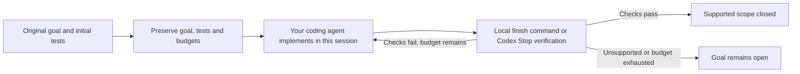

# GoalPilot

**Make coding goals verifiable. Spend less effort on repeated work.**

GoalPilot is a skill for **Codex, Claude Code and Antigravity**, backed by one local Python engine. It preserves your original goal and tests, gives the coding session a clear verification path, and checks the result before accepting completion. Failed checks are repaired in the same session, within the original deadline and verification budget.

[](pyproject.toml)
[](docs/HOSTS.md)
[](goalpilot/__init__.py)

[Get started](docs/GETTING_STARTED.md) · [Supported hosts](docs/HOSTS.md) · [How it works](docs/ARCHITECTURE.md) · [Benchmark methodology](docs/BENCHMARKS.md) · [Contributing](CONTRIBUTING.md)

## Measured performance

In the recorded **Codex benchmark on 20 selected synthetic Python service missions**, the complete GoalPilot invocation used **54.39% fewer raw tokens** and **60.66% less total time** than native Codex `/goal`. Claude Code and Antigravity adapters have not been benchmarked.


| Metric — all 20 attempts per arm | Native Codex | GoalPilot | Reduction |
| :--- | ---: | ---: | ---: |
| Total elapsed time | 65.32 min | 25.69 min | **60.66%** |
| Uncached input tokens | 499,412 | 256,343 | **48.67%** |
| Output tokens | 221,009 | 86,013 | **61.08%** |
| Raw tokens, including cached input | 4,716,581 | 2,151,252 | **54.39%** |
| Goal completion¹ | **19/20 (95%)** | **20/20 (100%)** | Observed on this benchmark |

¹ A completed goal must finish normally and pass all required external behavioral checks. Counts use the reviewed grader applied to both tools; [original scores and grading changes](docs/BENCHMARKS.md#original-versus-reviewed-scoring) remain documented. This is an observed result on 20 missions, not a guarantee for new tasks.

**What these numbers cover:** the entire calling session, including skill setup and reading, context, coding, repairs and Stop verification, plus independent judging time. Failed attempts remain in the totals. Both arms used `gpt-6.1-sol`, LOW effort and matching execution permissions. Native Codex used its real goal API and automatic continuations.

**What they do not establish:** savings on arbitrary repositories, multi-hour production goals or other agents. These are known development cases in one Python/JSONL/HTTP service family, not a blinded holdout. Provider tokens do not map directly to subscription quota percentages. See the [methodology, uncertainty and research cost](docs/BENCHMARKS.md).

## Install

Requirements: **Python 3.11+, a POSIX environment, and your chosen coding agent with terminal access**. Claude Code and Antigravity do not need Codex installed.

```bash
git clone https://github.com/InfinitySpeed/goalpilot.git
cd goalpilot
python3 install.py --host all
```

Or install for just one tool:

```bash
python3 install.py --host codex
python3 install.py --host claude-code
python3 install.py --host antigravity
```

Reload skills or restart your tool, then invoke GoalPilot:

| Tool | Invocation | Verification |
| :--- | :--- | :--- |
| Codex | `$goalpilot <goal>` | Explicit finish, or automatic Stop hooks when configured. |
| Claude Code | `/goalpilot <goal>` | The skill calls local verification before concluding. |
| Antigravity IDE / App | Ask the agent to use GoalPilot for your goal. | The skill calls local verification before concluding. |
| Antigravity CLI | `/goalpilot <goal>` | The same portable adapter and local engine. |

For example, in Codex:

```text
$goalpilot Add durable task scheduling to this Python service. Preserve its current
API and data. Cover scheduling, cancellation, restart recovery and concurrent
workers with meaningful tests. Finish only when the frozen checks pass.
```

No separate inference service, Python runtime dependencies or additional API key is required for the skill path. **Your coding agent still consumes tokens.** Installation and local verification do not create model calls.

For Codex's optional automatic Stop verification, configure its hooks after installation:

```bash
python3 ~/.agents/skills/goalpilot/scripts/goalpilot.py hook-config install
```

This hook setup is for Codex only; the other adapters work without it. The recorded Codex benchmark used the automatic-hook path. See [host adapters and custom paths](docs/HOSTS.md).

See [setup, manual operation and troubleshooting](docs/GETTING_STARTED.md).

## How it works



- **Preserve acceptance.** Initial tests are retained. The strengthened suite and submitted checks are frozen before final verification, so weakening a working test cannot erase the initial gate.
- **Reduce repeated work.** Compact context, exact-hash helper reuse and optional storage/transport/test helpers avoid repeatedly generating the same infrastructure.
- **Diagnose loops locally.** Hooks observe supported commands and report repeated failures; they do not launch another model or silently retry the task.
- **Verify completion.** Successful verification requires the retained original suite, the strengthened suite and submitted checks. Unsupported verification remains open.

Passing tests establishes the supported checked scope. It does not prove every unstated intention in a vague goal. Read the [architecture and boundaries](docs/ARCHITECTURE.md).

## Compatibility

| Host or project | Current status |
| :--- | :--- |
| Codex CLI | Native skill and optional Stop hooks; recorded Codex benchmark available. |
| Claude Code | Installable skill adapter using explicit local verification; no host performance benchmark. |
| Antigravity IDE, App and CLI | Installable skill adapter using explicit local verification; no host performance benchmark. |
| Bounded Python `unittest` projects with compatible initial tests | Supported verification path |
| Other agents | No dedicated adapter supplied. |
| Other test frameworks, oversized snapshots, unsupported environments | Supported closure is not claimed |

Optional helpers suit their documented interfaces. `ReplayService` is intended for new pure applications with a compatible storage format; existing formats and external side effects require a different strategy. See [architecture](docs/ARCHITECTURE.md).

## Development

The engine uses the Python standard library. The published version has **283 passing offline tests, with no skips**.

```bash
python3 validate.py
python3 tools/check_benchmark.py
python3 tools/build_skill.py
```

`dist/goalpilot-skill.zip` contains the original self-contained Codex bundle. The repository's `install.py` derives the other host bundles locally. These commands run local verification and packaging; they do not launch model benchmarks. See [CONTRIBUTING.md](CONTRIBUTING.md) for chart generation and measurement rules.
