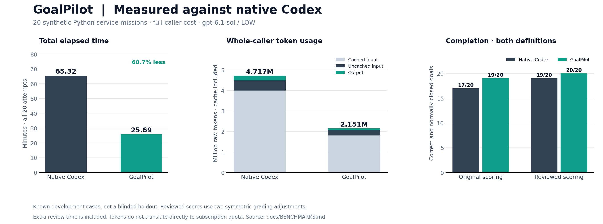
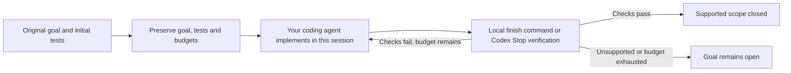

# GoalPilot

**Make coding goals verifiable. Spend less effort on repeated work.**

GoalPilot is a skill for coding agents that helps complete ambitious goals with local verification, focused repairs, and less repeated work. It uses one local Python engine. It preserves your original goal and tests, gives the coding session a clear verification path, and checks the result before accepting completion. Failed checks are repaired in the same session, within the original deadline and verification budget.

[](pyproject.toml)
[](docs/HOSTS.md)
[](goalpilot/__init__.py)

[Get started](docs/GETTING_STARTED.md) · [Supported hosts](docs/HOSTS.md) · [How it works](docs/ARCHITECTURE.md) · [Benchmark methodology](docs/BENCHMARKS.md) · [Contributing](CONTRIBUTING.md)

## Recorded benchmark (Codex skill 1.3.1 / engine 0.12.1)

In the recorded **Codex benchmark on 20 selected synthetic Python service missions**, the complete GoalPilot invocation used **54.39% fewer raw tokens** and **60.66% less total time** than native Codex `/goal`. Claude Code and Antigravity adapters have not been benchmarked.



| Metric — all 20 attempts per arm | Native Codex | GoalPilot | Reduction |
| :--- | ---: | ---: | ---: |
| Total elapsed time | 65.32 min | 25.69 min | **60.66%** |
| Uncached input tokens | 499,412 | 256,343 | **48.67%** |
| Output tokens | 221,009 | 86,013 | **61.08%** |
| Raw tokens, including cached input | 4,716,581 | 2,151,252 | **54.39%** |
| Goal completion¹ | **19/20 (95%)** | **20/20 (100%)** | Observed on this benchmark |

¹ A completed goal must finish normally and pass all required external behavioral checks. Counts use the reviewed grader applied to both tools; [original scores and grading changes](docs/BENCHMARKS.md#original-versus-reviewed-scoring) remain documented. This is an observed result on 20 missions, not a guarantee for new tasks.

**What these numbers cover:** the entire calling session, including skill setup and reading, context, coding, repairs and Stop verification, plus independent judging time. Failed attempts remain in the totals. Both arms used `gpt-6.1-sol`, LOW effort and matching execution permissions. Native Codex used its real goal API and automatic continuations.

**What they do not establish:** savings on arbitrary repositories, multi-hour production goals or other agents. These are known development cases in one Python/JSONL/HTTP service family, not a blinded holdout. Provider tokens do not map directly to subscription quota percentages. See the [methodology, uncertainty and research cost](docs/BENCHMARKS.md).

## How to use it

### 1. Send this to your coding agent

```text
Install GoalPilot from https://github.com/InfinitySpeed/goalpilot for the agent
I am using. Follow INSTALL.md, handle the runtime and skill registration yourself,
and confirm the local doctor check passes. Do not run benchmarks or start another
coding agent. Then tell me how to invoke GoalPilot here.
```

Or install and start your first task in one prompt:

```text
Install GoalPilot from https://github.com/InfinitySpeed/goalpilot if needed,
then use it to achieve this goal: [YOUR COMPLETE GOAL].
Work in this session, preserve existing tests and data, and verify the result
before reporting completion.
```

The agent handles source download, Python runtime setup, host selection and installation. It needs terminal access and normal permission to install user-local files. **Agents installing this repository: read [INSTALL.md](INSTALL.md) and complete the requested setup.** No manual Git or Python management is needed through the bootstrap.

### 2. Give it an objective

| Tool | Ready-to-copy prompt after installation |
| :--- | :--- |
| Codex | `$goalpilot [YOUR COMPLETE GOAL]. Preserve existing behavior and verify before concluding.` |
| Claude Code | `/goalpilot [YOUR COMPLETE GOAL]. Preserve existing behavior and verify before concluding.` |
| Antigravity | `Use the GoalPilot skill to achieve: [YOUR COMPLETE GOAL]. Verify before concluding.` |
| Hermes Agent | `Load the GoalPilot skill and use it to achieve: [YOUR COMPLETE GOAL]. Verify before concluding.` |
| T3 Code | `Use GoalPilot with this session's underlying coding agent to achieve: [YOUR COMPLETE GOAL].` |
| Other coding agents | `Read the installed GoalPilot SKILL.md and follow it for: [YOUR COMPLETE GOAL].` |

Use the full objective, constraints and important workflows. Codex can use optional automatic Stop hooks on POSIX; other adapters use explicit local verification before concluding. T3 Code uses its provider's skill support. For an unknown host, the installer returns an explicit skill path; native automatic discovery is only claimed where documented.

### Optional: install directly

Already have Python 3.11+ and the repository? Run `python install.py`. It defaults to **auto**, chooses the current/discovered host, and verifies the installed command. It does not configure every tool. Use `--host hermes`, `--host claude-code`, etc. to select explicitly, or `--host generic --target <native-skill-directory>/goalpilot` for another tool.

For dependency-free onboarding, the shell and PowerShell bootstraps prepare a user-local Python when needed, download source without Git and run the same installer. See [INSTALL.md](INSTALL.md) and [host adapters](docs/HOSTS.md). `--doctor` checks readiness without model calls; `--dry-run` previews destination paths.

The current local verifier supports bounded Python unittest projects on Linux/macOS/Windows. The optional cross-process `service_race` helper still requires POSIX fork. Other test frameworks and arbitrary hosted agents are not automatically supported. Your coding agent still consumes tokens; local installation and verification do not launch models.

## How it works



- **Preserve acceptance.** Initial tests are retained. The strengthened suite and submitted checks are frozen before final verification, so weakening a working test cannot erase the initial gate.
- **Reduce repeated work.** Compact context, exact-hash helper reuse and optional storage/transport/test helpers avoid repeatedly generating the same infrastructure.
- **Diagnose loops locally.** Hooks observe supported commands and report repeated failures; they do not launch another model or silently retry the task.
- **Verify completion.** Successful verification requires the retained original suite, the strengthened suite and submitted checks. Unsupported verification remains open.

Passing tests establishes the supported checked scope. It does not prove every unstated intention in a vague goal. Read the [architecture and boundaries](docs/ARCHITECTURE.md).

## Compatibility

| Host or project | Current status |
| :--- | :--- |
| Codex CLI | Native skill and optional Stop hooks; recorded Codex benchmark available. |
| Claude Code | Native skill directory; explicit local verification. |
| Antigravity IDE, App and CLI | Installable skill adapter using explicit local verification; no host performance benchmark. |
| Bounded Python `unittest` projects with compatible initial tests | Supported verification path |
| Hermes Agent | Profile-aware native skill directory; explicit local verification. |
| T3 Code | Uses the selected underlying provider; no fictional T3 skill directory. |
| Other coding agents | Generic bundle and custom native directory or explicit-load fallback; discovery depends on the host. |
| Other test frameworks, oversized snapshots, unsupported environments | Supported closure is not claimed |

New engine0.13.0 and adapters have not been model-benchmarked. Recorded performance belongs to the archived Codex reference above.

Optional helpers suit their documented interfaces. `ReplayService` is intended for new pure applications with a compatible storage format; existing formats and external side effects require a different strategy. See [architecture](docs/ARCHITECTURE.md).

## Development

The engine uses the Python standard library. The published version has **283 passing offline tests, with no skips**.

```bash
python3 validate.py
python3 tools/check_benchmark.py
python3 tools/build_skill.py
```

`dist/goalpilot-skill.zip` contains the current self-contained Codex bundle. The repository's `install.py` derives the other host bundles locally. These commands run local verification and packaging; they do not launch model benchmarks. See [CONTRIBUTING.md](CONTRIBUTING.md) for chart generation and measurement rules.
