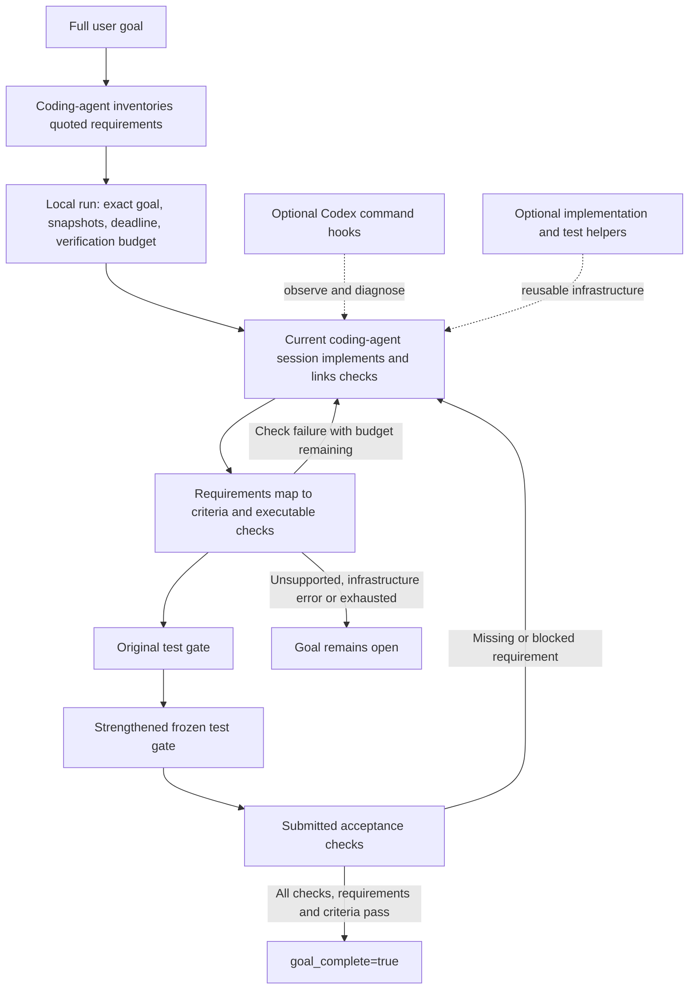

# Architecture

GoalPilot combines instructions for the calling agent with a local Python verification engine. The default path has no hosted GoalPilot service, separate reasoning model or background model fleet.

## Components

| Component | Responsibility |
| :--- | :--- |
| [Host installer](../install.py) and [portable adapter](../skills/goalpilot-016/scripts/host.py) | Auto-select or explicitly configure native/generic skills, prepare a runtime and use explicit verification where native Stop hooks are absent. |
| [Generalized instructions](../integrations/native/routed-SKILL.md) | Save the full request, guide implementation and avoid unnecessary repeated reads or verification. |
| [Native protocol](../integrations/native/native.py) and [specialized session](../goalpilot/session.py) | Preserve the original contract, freeze acceptance, account for verification attempts and invalidate closure after source changes. |
| [Criterion mapper](../goalpilot/criteria.py) | Require an exact-quoted requirement inventory, ensure every requirement and criterion maps, validate check links, and report verified, missing, blocked or pending status. |
| [Test gates](../goalpilot/gates.py) | Execute retained tests against disposable worktree copies. The strengthened suite supplements the original suite. |
| [Local hooks](../goalpilot/hooks.py) | Connect Codex command events and Stop to the local protocol. |
| [Passive monitor](../goalpilot/monitor.py) | Report repeated failure patterns and bounded diagnostic tails without inference. |
| [Optional runtime kit](../goalpilot/runtime_kit.py) | Supply compatible storage, transport and testing infrastructure. |

## Where the savings can come from

The skill supplies one compact API and discourages redundant helper reads, repeated full-suite runs and separate generation/readback rounds. Supplied helper files are excluded from repeated model context only when their exact size and hash match the expected versions; their original snapshots remain preserved. Modified or foreign files with the same names stay visible.

Optional helpers avoid reimplementing generic infrastructure. Business workflows and meaningful assertions still belong to the project. The measured benefit combines these mechanisms; the experiment does not isolate a causal percentage for each component.

`ReplayService` is an opt-in base for new pure applications with an unspecified compatible storage/backup format. It records accepted transitions and validates restored state by replay. Reducers require explicit request times and controlled entropy; external side effects are unsuitable. Cold replay is linear, and the default configurable event limit is 4,096. `ServiceBase` supports existing formats with a full application validator. See the [helper reference](../skills/goalpilot-016/references/sdk.md).

## What completion means

The protocol retains the original goal bytes, original tests, goal-derived requirement inventory and criteria, linked checks, source fingerprints and verification outcomes. New-format handoffs quote each requirement and criterion from the original goal and map every requirement to criteria; criteria link to submitted checks or state an explicit blocker. Handoffs without the requirements field remain compatible through a labeled one-to-one projection from their criteria; this preserves legacy behavior but cannot prove completeness. Repair does not renew the deadline or replace frozen acceptance. A source change after verification invalidates closure on the next protocol check.

These are local integrity receipts, not tamper-proof signatures. GoalPilot reports requirement and criterion coverage and check outcomes. The calling agent still creates the requirement inventory: exact quotes and complete mappings do not prove that it identified every meaningful outcome in a vague request. Tests are evidence for stated criteria, not proof that unstated intent was captured. Bounded snapshots are not a consistent backup of a concurrently edited database.

## Model usage and portability

The passive monitor and verification commands run Python and subprocesses, not inference. Repair still consumes the calling model's tokens. Total caller usage is unknown without external metering; a local token ceiling cannot enforce usage it cannot observe.

Automatic hook delivery is integrated with Codex on POSIX. Other hosts and Windows use installable adapters with explicit local verification and repair instructions in the calling session. They do not install or depend on Codex hooks. The same engine is bundled for each host; the portable launcher avoids accidentally inheriting a Codex hook binding. See [host adapters](HOSTS.md).

The current [whole-skill benchmark](PROMOTION-1.11.md) covers Skill 1.11 on Codex POSIX with explicit verification. Other hosts and explicit fallback have local installation/verification coverage, not model-performance evidence. The [older skill benchmark](BENCHMARKS.md) remains a separate archive.

## Installation portability

The repository entry point guides agents through INSTALL.md. Shell/PowerShell bootstraps prepare a user-local Python when needed; installed skills record its executable. The specialized engine uses msvcrt/Windows Job Objects or POSIX flock/process groups. The native adapter runs explicit argv checks in disposable copies and enforces subprocess deadlines. Snapshot inventory paths use POSIX separators across systems. Optional fork-based race probes remain POSIX-only. The default composes the exact frozen r2 service bundle with the separately measured native adapter. Native test drafts can receive explicit pre-green revisions; all snapshots/failures remain, and accepted tests then freeze. The older Skill 1.3.1/engine 0.12.1 remains a separate immutable reference.
