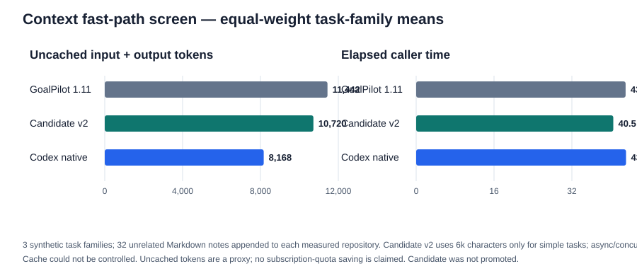

# Context fast-path candidate screen

This screen tested whether GoalPilot could spend less context on a small, bounded repair while preserving its complete workflow for complex work. It did **not** qualify as a promotion.

The summary below weights Java, Python and Node equally, rather than weighting Java more because it had more repeats.

| Three-family mean | Codex native | GoalPilot 1.11 | Restricted context candidate | Candidate change vs current |
| :--- | ---: | ---: | ---: | ---: |
| Independent judges passed | 3/3 | 5/5 | **5/5** | no decline |
| GoalPilot closures; original goal preserved | n/a | 5/5; 5/5 | **5/5; 5/5** | equal |
| Uncached input + output tokens | 8,168 | 11,442 | **10,720** | **−6.3%** |
| Raw tokens, including cached input | 87,912 | 57,494 | **54,254** | −5.6% |
| Elapsed seconds | 43.13 | 43.05 | **40.50** | −5.9% |

The restricted candidate still used **31.2% more uncached tokens than Codex native** across these matched cases. The large raw-token difference is descriptive and is not evidence of subscription-quota savings. This candidate therefore remains unpromoted; the stable profile stays at GoalPilot 1.11.

## What was tested

All runs used fresh Codex app-server threads, `gpt-6.1-sol`, low effort, the same synthetic task source per family, and an independent judge run after each final response. For the large-context cohort, each task repository received 32 unrelated Markdown notes (about 35 KB) to test context-volume sensitivity. This is a controlled synthetic stress case, not a production-repository sample. The provider cache could not be disabled, and execution order was not randomized.

The restricted candidate used a 6,000-character context budget for one-file bug fixes or simple utilities. It retained 18,000 characters for asynchronous/concurrent work and other complex goals. The existing service route retains its separate 12,000-byte dossier limit. Candidate v2 passed the independent judge and preserved GoalPilot closure on all five trials. The ambitious Flowdesk route was not re-run; its instructions and budget were left unchanged, so this screen does not provide new ambitious-goal evidence.

| Task family | Current GoalPilot uncached tokens / seconds | Candidate uncached tokens / seconds | Codex native uncached tokens / seconds |
| :--- | ---: | ---: | ---: |
| Java range utility (3 repeats) | 11,282 / 46.74 | **9,512 / 44.63** | 12,854 / 52.94 |
| Python dependency repair (1 pair) | 11,001 / 38.22 | **10,865 / 36.33** | 4,774 / 30.50 |
| Node async pool, candidate kept full context (1 pair) | 12,043 / 44.18 | **11,782 / 40.54** | 6,875 / 45.96 |

## Rejected iterations

The first fast-context version also used 6,000 characters for asynchronous work. Across four Node pairs it reduced mean uncached tokens by 28.8%, but took **15.1% longer** on average. That exceeded the speed gate, so the refined candidate restores the full context for async/concurrent work. A single small-repository Java pair also showed **25.9% more uncached tokens** with the short context, despite 1.0% fewer raw tokens; the cap helps only when the supplied context is actually large.

A separate direct-coding fast path skipped GoalPilot's local session for Python. It passed the independent judge but had no GoalPilot closure receipt and used 9,470 uncached tokens versus 4,774 for native Codex. That path was rejected too.

All trials—including the rejected routes and the initial profile-mismatched run—are retained in the machine-readable [screen report](../reports/context-fast-exploration-2026-10-23.json) and [evidence archive](../reports/context-fast-exploration-evidence-2026-10-23.zip). The report includes per-run raw input, cached input, output, uncached tokens, wall time, independent judgment and closure receipts.

## Decision

The 6,000-character cap produces a modest improvement over current GoalPilot in this synthetic screen, but does not beat native Codex on uncached tokens and does not establish a quota saving. No version is promoted. For a narrow, obvious repair, native Codex remains the lower-cost choice in these measurements; GoalPilot's complete criteria-and-closure workflow is for broader or ambiguous goals.
