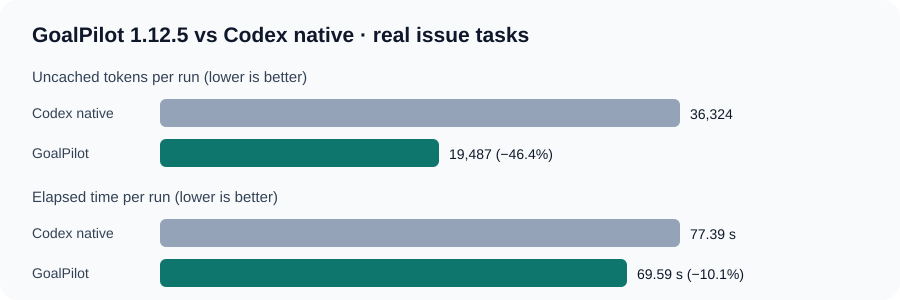

# GoalPilot 1.12.5: scoped promotion against Codex native

GoalPilot 1.12.5 promotes FAST DIRECT only for localized, single-behavior bug reports with an independently checkable outcome. Ambiguous, broad, stateful, cross-file, external, or under-tested goals use the full GoalPilot workflow. Direct mode does not issue a GoalPilot completion certificate.

## Matched real-task results

The control is Codex native `/goal` only. The experiment used SWE-bench Lite pytest issue `pytest-dev__pytest-7220` and Requests issue `psf__requests-2317`, the same issue prompt and base commit within each match, `gpt-6.1-sol` at low effort, fresh sessions, and independent hidden FAIL_TO_PASS/PASS_TO_PASS checks. Each arm has two measurements per task family. Provider cache could not be disabled; raw, cached-input, and uncached usage are retained.

| Equal-weight mean across task families | Codex native | GoalPilot 1.12.5 | Change
| :--- | ---: | ---: | ---: |
| Independent hidden checks | 2/4 | **4/4** | +2 successful runs
| Uncached tokens per run | 36,324 | **19,487** | **−46.4%**
| Elapsed time per run | 77.39 s | **69.59 s** | **−10.1%**
| Raw tokens per run (descriptive only) | 319,012 | 197,471 | −38.1%

The independent checker passed all four candidate runs. Both native pytest runs failed the hidden traceback-path behavior; all four Requests runs passed. Project verification is separately retained: candidate pytest r105 had a focused pass but three secondary failures because Pygments is unavailable; r106 passed 461 tests (9 skipped, 5 deselected, 2 xfailed). Requests passed 8 and 10 focused tests in its two runs. Native runs also report their test selection and failed network/dependency checks in the evidence archive.

The aggregate gain is limited and uneven: pytest time was approximately neutral across repetitions, while Requests improved. This is a scoped real-task promotion, not evidence for all programming work or vague ambitious goals. No quota-saving claim is inferred from raw token reduction.

## Earlier exploration and retained failures

The promoted candidate is the exact 1.12.5 routing prompt. Earlier experimental variants were not promoted: 1.12.0 and 1.12.1 Flask attempts failed hidden checks; 1.12.2/1.12.3 Requests attempts passed hidden checks but were slower than native; 1.12.3 pytest failed the hidden check; and 1.12.4 stopped on an incorrect authored test expectation. They remain in the local benchmark archive and are not controls for this release.

The [task prompt file](../benchmarks/native-task-domination-tasks-2026-10-24.json) contains the exact two goals and base commits, without hidden tests. The [machine-readable report](../reports/native-task-domination-2026-10-24.json) preserves per-run measurements and limitations. The [evidence archive](../reports/native-task-domination-evidence-2026-10-24.zip) contains run records, agent event streams, messages, verification output, and hidden-check results. The [older synthetic report](../reports/skill-112-adaptive-fast-path-2026-10-24.json) remains available as historical evidence and is not used for this promotion.
