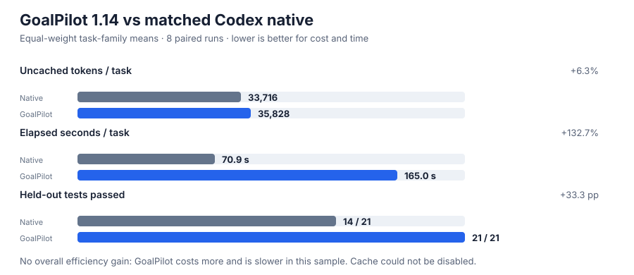

# GoalPilot 1.14: auditable acceptance amendments

GoalPilot 1.14 adds a controlled way to amend required verification after implementation reveals a missing test or an invalidated fixture. An amendment preserves the verbatim goal, passing evidence, blocker text, existing checks, and prior attempts. It records a SHA-256-checked acceptance history, permits only new required checks and demotion of a previously failed required check to diagnostic, and is rejected after success. The status report exposes the amendment history and prior failures. This makes recovery reviewable without resetting or silently replacing the original acceptance record.

## Matched comparison with Codex native

All performance controls in this report are Codex native `/goal` on the same task. No prior GoalPilot version is a control. We ran eight matched pairs on three upstream issues with `gpt-6.1-sol` at low reasoning effort: six Flask runs, one pytest run, and one Requests run. Both arms received the same problem statement, base commit, and environment. Each run used fresh working state and complete provider usage records. We retained incomplete runs and harness incidents.

The table gives task-family means, then weights the three task families equally so repeated Flask runs do not dominate. Lower cost and time are better; higher pass and certification rates are better.

| Measure | Codex native | GoalPilot 1.14 | GoalPilot change |
| :--- | ---: | ---: | ---: |
| Raw tokens per task | 240,962 | 516,389 | +114.3% |
| Cached input tokens per task | 207,246 | 480,562 | +131.9% |
| Uncached tokens per task | 33,716 | 35,828 | +6.3% |
| Elapsed seconds per task | 70.9 | 165.0 | +132.7% |
| GoalPilot/Codex certificate count | 8/8 | 7/8 | −1 candidate certificate |
| Hidden tests passed | 14/21 | 21/21 | +7 passed tests |

The primary reliability signal is hidden-test behavior, not the product's own certificate: GoalPilot passed all 21 saved holdout tests while Codex native passed 14. Nevertheless, GoalPilot failed to certify one run that Codex native certified. The current evidence supports a narrower claim: the tested GoalPilot changes produced correct behavior on these holdouts and provide recoverable acceptance amendments. It does **not** show a general improvement in task completion, speed, or quota consumption.

Per-task-family results:

| Upstream task | Pairs | Measure | Codex native | GoalPilot 1.14 |
| :--- | ---: | :--- | ---: | ---: |
| Flask `pallets__flask-4045` | 6 | Uncached tokens | 19,892 | 59,603 |
|  |  | Elapsed seconds | 47.9 | 155.4 |
|  |  | Goal certificates | 6/6 | 5/6 |
|  |  | Holdout tests | 6/12 | 12/12 |
| pytest `pytest-dev__pytest-7220` | 1 | Uncached tokens | 39,483 | 28,600 |
|  |  | Elapsed seconds | 123.3 | 272.5 |
|  |  | Goal certificates | 1/1 | 1/1 |
|  |  | Holdout tests | 0/1 | 1/1 |
| Requests `psf__requests-2317` | 1 | Uncached tokens | 41,772 | 19,280 |
|  |  | Elapsed seconds | 41.5 | 67.0 |
|  |  | Goal certificates | 1/1 | 1/1 |
|  |  | Holdout tests | 8/8 | 8/8 |

### Test results and retained failures

- The Flask holdout is the original SWE-bench Lite `FAIL_TO_PASS` patch. The six native candidates rejected a dotted blueprint endpoint; the six GoalPilot candidates passed both holdout nodes. GoalPilot run 6 still did not certify its goal, even though the two holdout nodes passed.
- The pytest holdout reproduces a changed-working-directory failure. Native failed it; GoalPilot passed it. The full diagnostic suite reported 2,700 passed, 55 failed, and 7 errors in GoalPilot's run; its baseline replay matched the original failures. Those broad-suite failures remain diagnostic and are included in the evidence.
- Requests' eight holdout tests passed in both arms. Its full online suite could not run against the intentionally network-isolated environment; twelve focused offline cases passed for GoalPilot.
- A supplemental, post-run Flask probe for nested blueprint URL defaults passed in GoalPilot runs 10 and 11 and failed in native runs 10 and 11. It is reported separately and excluded from the 21-test holdout total.
- The first pytest holdout harness attempt referenced a missing Python environment and ran no tests. The runner path was corrected and all reported results were rerun. This setup incident is retained in the archive and is not counted as a product failure.
- Local native-workflow tests: **37 passed**; Python compilation passed. The full repository validation passed **388/388 tests** (Python 3.12.14; zero skips and no live API calls).

## Measurement limits

Provider cache could not be disabled. The report therefore separates cached input from uncached tokens; raw-token differences are not interpreted as subscription-quota savings. Equal task-family weighting is descriptive, not a population estimate. Only three upstream tasks were tested, and two families have one pair each. Holdout counts are small and task-specific. Wall time depends on this environment. No claim is made about other coding agents or hosts.

The full run records, caller usage, final outputs, GoalPilot acceptance state and amendment history, attempt logs, diffs, holdout output, test hashes, and harness incident are in [the evidence archive](../reports/native-only-evidence-2026-10-24.zip). The machine-readable results are in [the benchmark JSON](../reports/native-only-benchmark-2026-10-24.json), with separate [holdout results](../reports/native-hidden-tests-2026-10-24.json) and [supplemental probe](../reports/native-nested-url-probe-2026-10-24.json).
