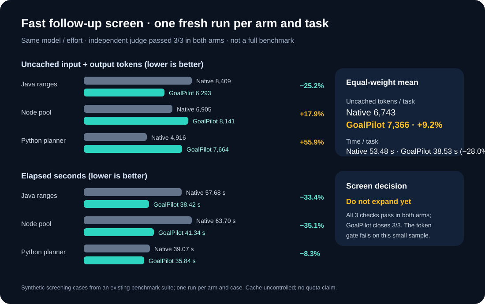

# GoalPilot 1.11 rapid task-diversity screen

This was a quick selection screen before any larger benchmark. The protocol was frozen before running the six fresh trials. Each arm ran once on the same Java range, Node worker-pool, and Python dependency-planner task, with a fresh Codex app-server thread, the same `gpt-6.1-sol` model and low effort. The tasks are synthetic cases reused from an earlier internal benchmark suite, not a fresh production sample.

| Fresh one-run-per-arm screen | Codex native | GoalPilot 1.11 | GoalPilot change |
| :--- | ---: | ---: | ---: |
| Independent task checks passed | 3/3 | **3/3** | equal |
| GoalPilot completion certificates | — | **3/3** | n/a |
| Equal-weight uncached input + output tokens per task | 6,743 | 7,366 | **+9.2%** |
| Equal-weight elapsed seconds per task | 53.48 | 38.53 | **−28.0%** |

The per-task results explain why the aggregate token result did not pass the predeclared screen gate:

| Task | Native uncached tokens | GoalPilot uncached tokens | Native seconds | GoalPilot seconds |
| :--- | ---: | ---: | ---: | ---: |
| Java ranges | 8,409 | 6,293 | 57.68 | 38.42 |
| Node worker pool | 6,905 | 8,141 | 63.70 | 41.34 |
| Python dependency planner | 4,916 | 7,664 | 39.07 | 35.84 |

All six results passed their independent judges, and all three GoalPilot runs produced a completion certificate preserving the original goal. GoalPilot was faster on all three, but its uncached tokens were lower on only one. The aggregate was **9.2% higher** than native, so this screen did **not** qualify for a full benchmark expansion. This does not establish that GoalPilot generally uses more tokens; the sample is too small for that claim too.

The existing repeated Flowdesk comparison is relevant to a vague ambitious goal but is prior evidence, so it is kept out of the fresh-screen aggregate: two runs per arm passed all 26 behavioral groups per run. GoalPilot averaged 18,868 uncached tokens and 97.21 seconds; native averaged 21,441 tokens and 148.19 seconds. See the [matched full report](PROMOTION-1.11.md).

## Supplemental refactor pair

To cover behavior-preserving refactoring, one separate pair asked both arms to extract duplicated JSON-lines parsing into a shared helper. Both implementations passed the corrected independent judge and their complete local unittest suites; GoalPilot also certified closure and preserved the original goal. It used **5,710 uncached tokens in 21.75 seconds** versus **6,868 tokens in 32.65 seconds** for native Codex (one run per arm).

The first version of the judge incorrectly expected a later parse error even though the specified earlier type error takes precedence. It marked both arms failed. We retained those original outcomes, corrected the judge without rerunning either model, and both arms passed the corrected judge. The correction and both judge versions are in the [supplemental evidence archive](../reports/native-screen-refactor-evidence-2026-10-23.zip). This single pair is excluded from the frozen screen aggregate and does not change its stop decision.

## Limits

- One fresh run per arm on each fresh-screen task; one failed screen gate is a stop signal for this iteration, not a statistical conclusion.
- Cases are synthetic and appeared in an earlier internal benchmark suite. This screen does not demonstrate performance on a broad set of real repositories.
- Bug repair, concurrent feature work and edge-case implementation each had one fresh pair. The dedicated refactor was a separate single pair and is excluded from the aggregate.
- Provider prefix cache could not be disabled. Raw token totals are retained in the machine-readable report, but are not used to claim quota savings.
- Flowdesk is prior repeated evidence, not a new run in this screen. Its details and exact traces remain in the [Skill 1.11 evidence archive](../reports/skill-111-evidence.zip).

Full raw trials, caller logs, frozen task source, protocol and runner: [native-screen-evidence-2026-10-23.zip](../reports/native-screen-evidence-2026-10-23.zip). Machine-readable results: [native-screen-2026-10-23.json](../reports/native-screen-2026-10-23.json).
